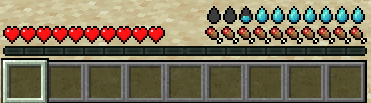
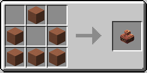
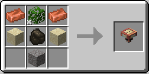

# Gameplay

This page describes the defaults. 
A modpack can change most things here through the [configuration](Configuration) or [datapacks](Modpack-Makers).

---

## The thirst bar
Like hunger, thirst has a hidden reserve, **hydration**. 

---

## What makes you thirsty

The same activity that makes you hungry makes you thirsty: sprinting, jumping, fighting, breaking blocks, healing. 
Thirst drops a little faster than hunger, and the climate affects it:

- **Hot and dry biomes** (desert, badlands, savanna) drain thirst faster. 
- **Cold and wet ones** drain it slower. High ground is colder, so thirst drains a bit slower there too.
- **The Nether** drains thirst three times faster. 
- **The End** counts as cold, about like a snowy biome.
- **Fire Resistance** stops the loss, and **Fire Protection** on armor lowers it.
- **Nausea** drains thirst.
- **Peaceful**: thirst does not go down. 

With Serene Seasons installed, seasonal weather affects biome climate. 
See [Compatibility](Compatibility).

---

## When thirst runs low

- **3 droplets or less**: you cannot sprint, even with a full hunger bar.
- **Not full**: health regenerates slower. Fast regeneration needs a full bar, and any regeneration needs at least 16 points (8 droplets).
- **Empty**: you take damage every 2 seconds. On Easy it stops at 5 hearts, on Normal at half a heart, and on Hard it can kill you.

You respawn with full thirst.

---

## Drinking

| Source | Thirst | Hydration | Notes |
|---|---|---|---|
| Water bottle | 4 | 5 | Two droplets. Pure water (5) gives 6 and 8 |
| Terracotta water bowl | 4 | 5 | Same as a bottle. The empty bowl goes back to your inventory |
| Sip by hand | 1 | 1 | Sneak and right-click water with both hands empty |
| Rain | 1 | 1 | Look up while it rains on you, one sip every half second, until your thirst is full |
| Milk bucket | 4 | 4 | |
| Honey bottle | 3 | 4 | |

Glass bottles and terracotta bowls also fill from flowing water. Buckets still need a source block.

Chests in dungeons, mineshafts, shipwrecks, Nether fortresses and bastions can hold a few water bottles, acceptable or pure.

### Food

Some food hydrates a little and some makes you thirstier. Plain food (bread, meat, most dishes) does nothing to thirst. The tooltip of every item that changes thirst shows how much, as droplets.

| Food | Thirst | Hydration |
|---|---|---|
| Melon slice | 4 | 4 |
| Beetroot soup | 3 | 3 |
| Apple, golden apple, potato, sweet and glow berries, chorus fruit, mushroom, rabbit and suspicious stew | 2 | 2 |
| Carrot, golden carrot, beetroot | 1 | 1 |
| Cake, per slice | 1 | 1 |
| Rotten flesh, spider eye, pufferfish, poisonous potato | -3 | -3 |

### Juices, soda and milk

A juice needs water that is at least acceptable.

| Drink | How to get it | Thirst | Hydration | Bonus |
|---|---|---|---|---|
| Apple Juice | Apple and a water bottle | 7 | 9 | Hydrated, 1 minute |
| Melon Juice | 2 melon slices and a water bottle | 8 | 10 | Hydrated, 2 minutes |
| Berry Juice | 2 sweet berries, sugar and a water bottle | 7 | 9 | Speed, 20 seconds |
| ABC Juice | Apple, beetroot, carrot and a water bottle | 10 | 14 | Hydrated for 3 minutes and Regeneration for 5 seconds |
| Soda Water | Fill a glass bottle on a bubble column | 3 | 4 | Speed, 15 seconds |
| Cola | Soda water, cocoa beans and sugar | 4 | 5 | Speed and Haste, 40 seconds |
| Milk Bottle | A milk bucket and 3 glass bottles make 3 | 3 | 4 | Cures what dirty water did to you and nothing else |

All of them leave the bottle behind. If another mod already makes the same drink, its recipe stays and this one turns off: Farmer's Delight covers apple, melon and milk, Expanded Delight apple and berry, Extra Delight berry, and Cultural Delights cola.

### Canteen

The Canteen carries 8 drinks of one kind: juice, soda, milk, a potion, water, also from other mods. Craft it with up to 8 identical drinks and you get each empty bottle back. Waters of different purity mix, and all of it drops to the dirtiest.

Right-click to take one sip, which counts as drinking that whole bottle: same thirst, food and effects. Right-click water to fill it, and it keeps the purity of that water. Right-click a tank or a cauldron to fill or empty it.

Pipes and machines can fill and empty a Canteen of water, 250 mB per sip.

### Amphora

The Amphora stores 4 buckets of water without changing it, so water keeps the purity you worked for. Bottles, buckets, terracotta bowls and Canteens go in and out with a right-click, and so do pipes and machines. Right-click with an empty hand to see what it holds.

Water of any purity goes in, and the whole Amphora drops to the dirtiest one, so one dirty bottle spoils it all. It takes other fluids too, never items. To move it, break it with an empty hand: it drops with its contents. You cannot drink from it. Anything else shatters it: a tool, an arrow, a falling anvil, an explosion. It leaves a few bricks, and its water spills and dries up.

### Charcoal Filter

The Charcoal Filter purifies water by gravity, with no pumps. Put it under a water cauldron or anything that holds water, such as an Amphora or a tank from another mod, and put a container under it. It pulls water from above, raises it one purity level, and passes it down at 1 mB per tick, so it is slow. With Create, the [Sand Filter](Compatibility#create) is the fast option.

Filters stack: each one in a column adds a level, up to pure. A cauldron under the filter only takes a whole bucket and does not keep the purity, so use an Amphora.

### Drinking too much

What you drink past full adds up. Three bottles past full in a short time give you **Overhydrated**: 10% slower movement and a few seconds of Nausea. The extra drains off at one point per second.

---

## Water purity

Water has one of six purity levels. Bottles, bowls and buckets of water show it in their tooltip, and the water in bottles and bowls is tinted by it, from brown to near white.

| Level | Name | Drinking it |
|---|---|---|
| 0 | Contaminated | Nausea and Hunger, 40% chance of Poison |
| 1 | Dirty | 60% chance of Nausea and Hunger, 15% chance of Poison |
| 2 | Murky | 25% chance of Nausea and Hunger |
| 3 | Acceptable | 5% chance of Nausea and Hunger |
| 4 | Clean | Nothing |
| 5 | Pure | Nothing, and it hydrates more: 6 thirst and 8 hydration per bottle |

Poisoned water still hydrates by default. A server can make Poison cancel the drink instead (`purity.toml` `general.quenchWhenDebuffed`).

Water of level 2 or worse, drunk in a hot climate (a desert, a savanna, badlands, the Nether), also gives **Dehydration**. Thirst then drops faster for 30 seconds.

### Where clean water is

Water taken from the world gets its purity from where it is:

- **Oceans** are always contaminated (0). They stand in for salt water.
- **Most biomes** (plains, forests, rivers) start dirty (1).
- **Taiga, birch forests and snowy biomes** start murky (2). **Mountains and windswept hills** start acceptable (3).
- **Deserts and badlands** start contaminated and never get better than murky (2). **Swamps and mangroves** start contaminated and never get better than dirty (1).
- **Running water** is one level better than still water.
- **Height** helps: water 30 blocks above sea level is one level better, 60 blocks two, 100 blocks three. Deep underground works the same way: 16, 48 and 80 blocks below sea level.

`/droplets debug purity` (operators) shows the purity of the water you look at and why.

Waters of different purity mix in any tank: the whole tank drops to the dirtiest one.

### Cleaning water

| Method | Result |
|---|---|
| Water cauldron | Murky (2), whatever went in |
| Water cauldron over a heat source (campfire, fire, magma block, lava) | Clean (4) |
| Campfire | One level up per cook |
| Furnace | Two levels up per cook |
| Smoker | Two levels up per cook, twice as fast. Off by default: turn on the datapack `mod/droplets_of_thirst:datapacks/purify_smoking` |

Cooking works on water bottles, water buckets and terracotta water bowls, and it reaches pure (5), or clean (4) with Create installed.

With JEI installed, the "Water Purification" page shows the cauldron and its heat sources. The cooking recipes show in their own pages.

If the server turns purity off, all water is the same and only thirst matters.

---

## Items

| Item | How to get it | Use |
|---|---|---|
| Clay bowl | 3 clay balls in a V shape give 4 | Cook it into a terracotta bowl |
| Terracotta bowl | Clay bowl in a furnace or on a campfire | Fill it with water like a glass bottle, from the world or a cauldron |
| Terracotta water bowl | Terracotta bowl filled with water | Drink it like a water bottle. It can be purified like a bottle |
| Charcoal Filter | Copper ingots, leaves, sand, charcoal and gravel, in a funnel shape. Leaves need shears | Purifies water by gravity. See [Charcoal Filter](#charcoal-filter) |
| Amphora | 6 terracotta | Stores 4 buckets of water and keeps its purity. See [Amphora](#amphora) |
| Canteen | Leather and 3 iron ingots | Carries 8 drinks of one kind. See [Canteen](#canteen) |

Everything is also in the Droplets of Thirst creative tab. The tab lists each water container once per purity.

---

## Effects and potions

| Effect | What it does | Source |
|---|---|---|
| Quenchness | Restores 1 thirst and 1 hydration every 2 seconds per level | Potion of Quenchness |
| Hydrated | Thirst drains at half the speed per level | Juices, `/effect`, or datapacks and config |
| Dehydration | Thirst drains faster, like Hunger does for food | Dirty water in a hot climate |
| Overhydrated | 10% slower per level | Drinking far past full |

| Potion | Effect | Brewing |
|---|---|---|
| Potion of Quenchness | Quenchness I, 0:45 | Awkward potion + prismarine crystals |
| Long | Quenchness I, 1:30 | Potion of Quenchness + redstone |
| Strong | Quenchness II, 0:22 | Potion of Quenchness + glowstone dust |

Gunpowder makes splash potions and dragon's breath makes lingering potions, as with vanilla potions.

---

## Other mods

Create, Farmer's Delight and its addons, Cold Sweat, Serene Seasons, Traveler's Backpack, Vampirism, Supernatural, Reliquary, JEI, EMI, Jade, AppleSkin and KubeJS all work with Droplets of Thirst. See [Compatibility](Compatibility), which also lists the mods that do not work with it.
